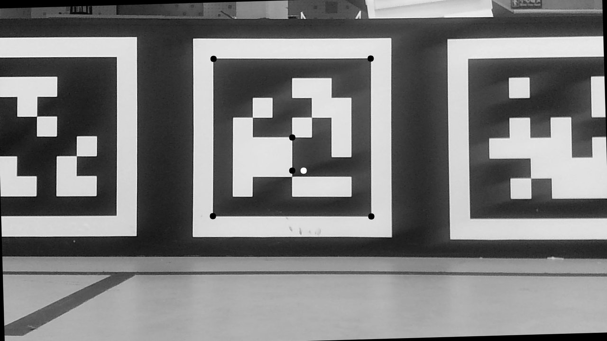
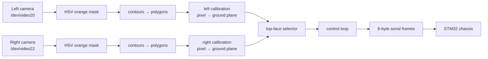
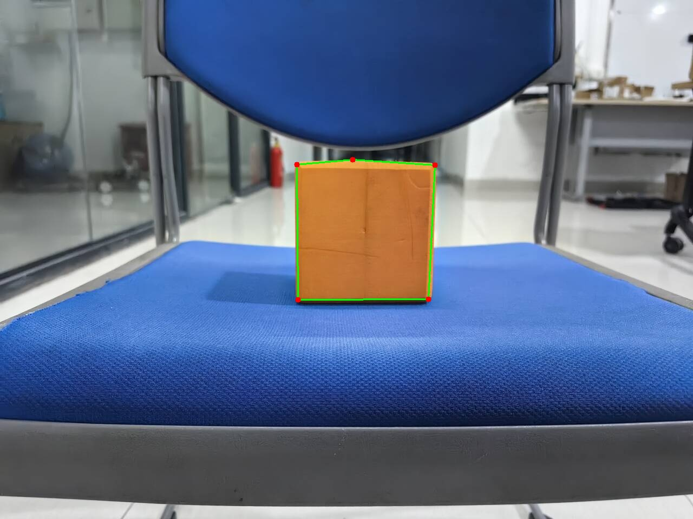

# 24Robo Vision

[](https://github.com/EatingNoLine/robogame-2024-vision/actions/workflows/ci.yml)
[](LICENSE)
[](pyproject.toml)

Vision stack for the **24Robo 2024** arena robot: two side cameras find an orange cube,
the robot drives to it, grabs it and shoots it at a target. The same code also
localises the robot against the arena wall by reading `tag36h11` AprilTags.

This repository is the **cleaned-up, tested version of the code that ran during the
2024 competition season**. It is archived: it is not being developed further, and the
hardware-dependent path has not been re-verified since (see [Status](#status)).



## How it works



1. **Segment** the orange cube with an HSV window, keep contours of a plausible
   area and simplify them with `approxPolyDP` (`detection/`).
2. **Project** the polygon vertices onto the robot's ground plane. Each side camera
   has its own calibration: a fixed-depth ray plus a homography (`geometry/camera_model.py`).
3. **Select** the cube's top-face centre. The top face is a ~101 mm square, so three of
   its corners form a right-isosceles triangle; the midpoint of the hypotenuse *is* the
   face centre. No PnP solve required (`geometry/cube_center.py`).
4. **Steer**: dead-band the offset, pick a speed gear from the travel distance and send
   a six-character frame over the serial link (`app.py`, `robot/`).
5. **Grab and shoot** once the cube is within 40 mm of the required position.

### Modules

| Module | Responsibility |
| --- | --- |
| `robogame_vision.config` | Every tuned constant, named and documented |
| `robogame_vision.camera` | V4L2 capture, background "latest frame" thread, replay source |
| `robogame_vision.detection.color` | HSV mask, vertex ordering, debug rendering |
| `robogame_vision.detection.cube` | Contours → cube-quad candidates |
| `robogame_vision.detection.apriltag` | Optional native AprilTag detector |
| `robogame_vision.detection.yolo_seg` | The abandoned YOLOv8-seg path (weights not shipped) |
| `robogame_vision.geometry.camera_model` | Calibration loading and pixel → ground projection |
| `robogame_vision.geometry.cube_center` | Right-isosceles top-face selector |
| `robogame_vision.geometry.tag_pose` | AprilTag distance / yaw estimate |
| `robogame_vision.robot.protocol` | Serial frame encoding and the gear table |
| `robogame_vision.robot.link` | `pyserial` transport + an in-memory fake |
| `robogame_vision.robot.controller` | Acknowledged commands with a bounded timeout |
| `robogame_vision.app` | Detection fusion and the control loop |
| `robogame_vision.cli` | `run`, `replay`, `detect-tag`, `teleop`, `preview` |

Deeper notes: [`docs/architecture.md`](docs/architecture.md),
[`docs/protocol.md`](docs/protocol.md),
[`docs/calibration.md`](docs/calibration.md),
[`docs/known-issues.md`](docs/known-issues.md).

## Quick start (no robot required)

```bash
git clone https://github.com/EatingNoLine/robogame-2024-vision.git
cd robogame-2024-vision
python -m venv .venv && . .venv/bin/activate   # Windows: .venv\Scripts\activate
pip install -e ".[dev]"
```

Run the whole cube pipeline over a still frame captured by a side camera:

```console
$ python -m robogame_vision.cli replay examples/cube_sample.jpg --json
{
  "image": "examples/cube_sample.jpg",
  "width": 1280,
  "height": 960,
  "quad_count": 1,
  "left":  {"found": false, "overlapping": false, "center": null},
  "right": {"found": false, "overlapping": false, "center": null}
}
```

`--save-vis overlay.png` writes the segmentation overlay:



On this sample the cube is seen from outside the arena, so the calibrated selector
correctly refuses to place it on the ground plane - the millimetre numbers only make
sense for frames from the arena cameras.

Run the tests (no camera, no chassis, no `torch`):

```console
$ python -m pytest
114 passed
```

## On the robot

The competition robot was an Orange Pi running Ubuntu with two USB cameras and an
STM32 chassis board on a USB serial adapter.

* Left camera on `/dev/video20`, right camera on `/dev/video22` (1920×1080).
* The chassis board exposes `/dev/my_serial0` through this udev rule:

  ```
  KERNEL=="ttyUSB[0-9]*", ATTRS{idVendor}=="1a86", ATTRS{idProduct}=="7523", MODE="0777", SYMLINK+="my_serial0"
  ```

Drive it:

```bash
python -m robogame_vision.cli run                 # left/right cameras + chassis
python -m robogame_vision.cli run --dry-run       # cameras only, print the frames
python -m robogame_vision.cli teleop              # keyboard control (needs the teleop extra)
python -m robogame_vision.cli preview --devices 20 22
```

## Serial protocol

Every command is six ASCII characters plus `\n`; the board replies `OK\n`.
`<gear>` selects the motor speed, derived from the travel distance.

| Command | Frame | Notes |
| --- | --- | --- |
| stay | `000000` | |
| move | `<gear><direction><distance:04d>` | e.g. `1b0400` = gear 1, 400 mm backwards |
| grab | `6<l\|r>0000` | close the left/right arm |
| shoot | `800000` | |
| rotate | `700000` | never implemented by the firmware |
| hello | `hello` | answered with a banner, not `OK` |

Gear ranges: `1` ≤ 500 mm, `2` ≤ 1200 mm, `3` ≤ 2500 mm, `4` ≤ 3000 mm, `5` ≤ 4000 mm.
Full details, including the arena geometry, in [`docs/protocol.md`](docs/protocol.md).

## Status

* **Archived.** The 2024 competition code, refactored - no new features are planned.
* **Hardware path not re-verified.** No robot was available when this version was
  prepared; camera capture, serial transport and the actual grasp/shoot sequence are
  untested against the hardware. Everything that can be verified off the robot is
  covered by the test suite.
* **Parity-tested.** The numeric behaviour (projection, segmentation, top-face
  selection) is pinned against values produced by the original scripts - see
  [`docs/known-issues.md`](docs/known-issues.md) for the exceptions.
* **YOLO weights not distributed.** The 6.4 MB `new.pt` checkpoint of the abandoned
  segmentation experiment is not part of this repository.

## 中文简介

这是 2024 年 RoboGame 比赛机器人的视觉代码，现已归档并整理为可测试的 Python 包。

- **两条侧向相机**找橙色方块，HSV 分割 + 多边形近似，再经标定投影到地面坐标系；
- **顶面选择**利用了"顶面是正方形"这一先验：三个角点构成等腰直角三角形，
  斜边中点即顶面中心，无需解 PnP；
- **同一条链路**下还有 AprilTag 测距（`tag36h11`，用于判定车头是否正对墙体）；
- **不依赖硬件即可验证**：`replay` 单图跑通整条立方体识别链路，
  `pytest` 114 个用例覆盖协议帧、投影、分割、选面与标签位姿，
  并使用重构前代码生成的"金标准"做数值对拍。

仓库已归档，不再继续开发；实机链路（相机 + 串口）在整理过程中没有条件重新验证，
详见 [`docs/known-issues.md`](docs/known-issues.md)。

## License

[MIT](LICENSE)
